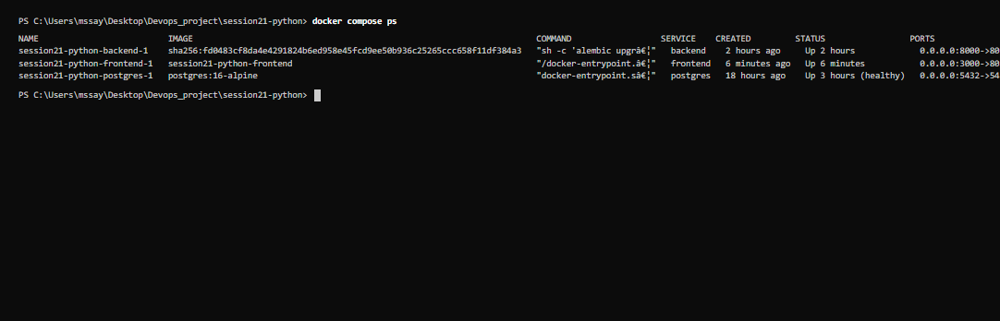
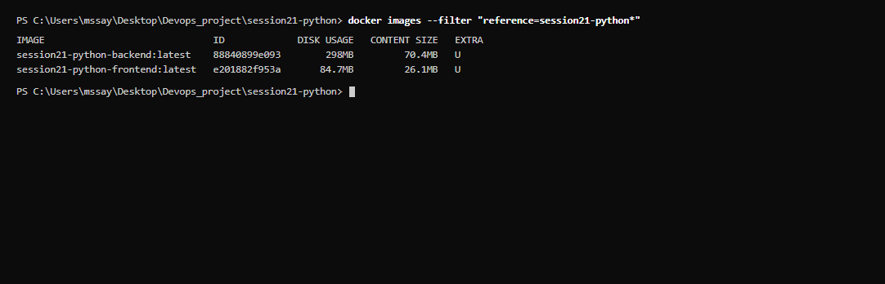
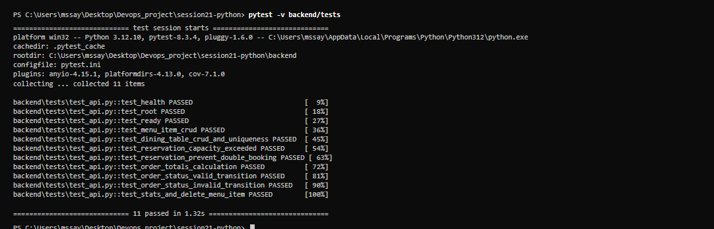
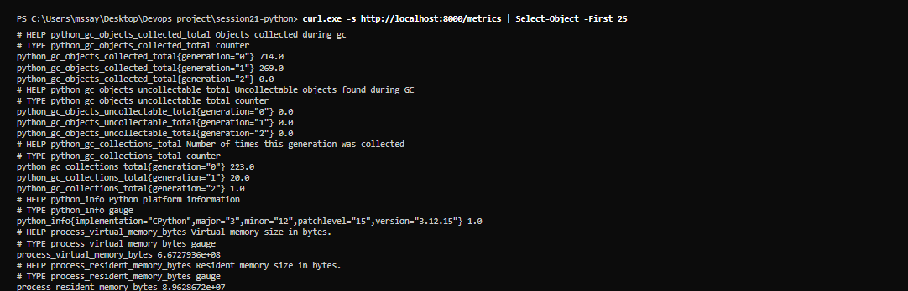
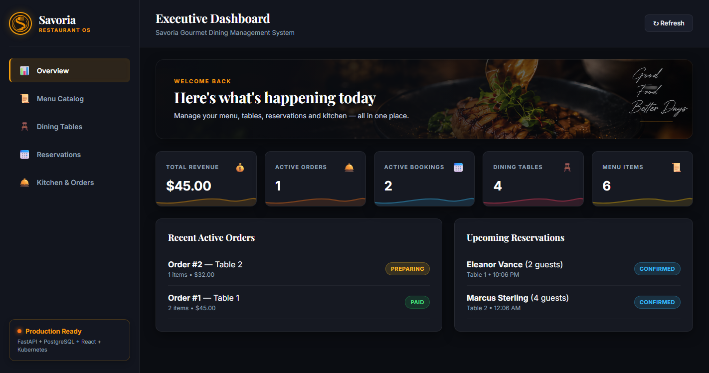
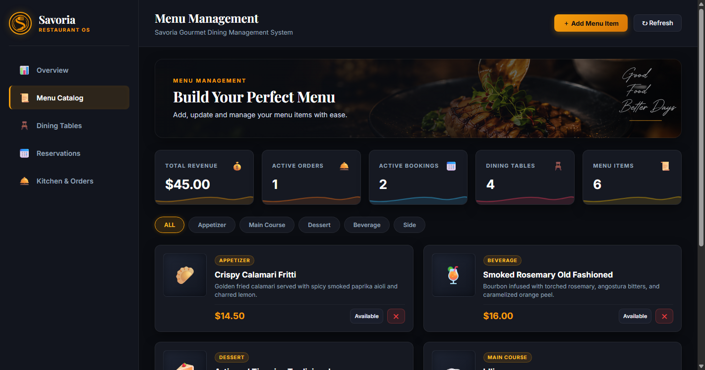
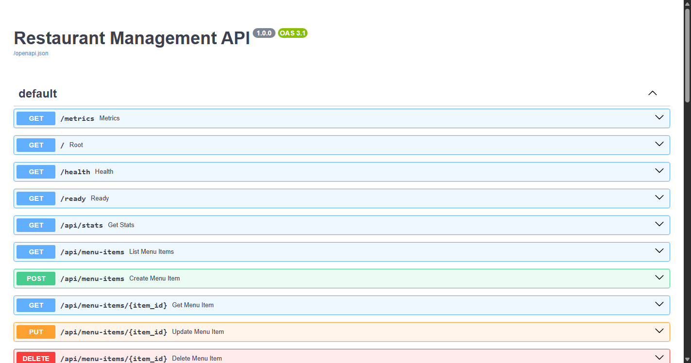

# Session 21 — DevOps Final Capstone: Savoria Restaurant Management System

**Author**: M S Sayed ([@MSSAYED11](https://github.com/MSSAYED11))  
**Email**: mssayed1108@gmail.com  
**Repository**: [https://github.com/MSSAYED11/Devops_SecA_Assignments/tree/main/Session%2021%3A%20Final%20DevOps%20Project](https://github.com/MSSAYED11/Devops_SecA_Assignments/tree/main/Session%2021%3A%20Final%20DevOps%20Project)  
**Demo Video / Screen Recording**: [TODO: Insert your screen recording link here (e.g. Loom, YouTube, or Google Drive)]

---

## 1. Project Overview

**Savoria** is an enterprise-grade full-stack Restaurant Management System built to streamline dining floor operations, table reservations, catalog management, and kitchen order processing (POS).

### Key Application Features & Domain Rules
1. **Executive Dashboard**: Real-time KPI cards displaying catalog size, table count, active reservations, active kitchen orders, and total revenue.
2. **Menu Catalog**: Full CRUD management of appetizers, main courses, desserts, and beverages with live availability toggling.
3. **Dining Floor Plan**: Interactive dining table management with location zones (Indoor, Patio, Window, Bar) and capacity constraints.
4. **Capacity Enforcement**: Reservations that exceed the assigned table's seating capacity are automatically rejected (`400 Bad Request`).
5. **Double-Booking Prevention**: Protects a 2-hour window (`±2 hours`) around confirmed/seated bookings for any given table (`409 Conflict`).
6. **Order State Lifecycle**: Kitchen orders follow a strict finite-state machine:
   $$\text{PLACED} \longrightarrow \text{PREPARING} \longrightarrow \text{SERVED} \longrightarrow \text{PAID}$$
   (or $\text{CANCELLED}$ from $\text{PLACED}$ / $\text{PREPARING}$). Invalid jumps return `400 Bad Request`.
7. **Automated Order Totals**: Automatically calculates line-item prices (`unit_price * quantity`) from the active menu catalog and computes total billing amounts.

---

## 2. Architecture & Tech Stack

```text
Developer Workstation
       │
       ▼
GitHub Repository (main branch)
       │
       ▼
GitHub Actions CI/CD Pipeline
  ├── Pytest Backend Test Suite (11 test cases)
  ├── Frontend Production Build (Vite)
  ├── Non-Root Docker Image Builds (Backend & Frontend)
  ├── Trivy Security Vulnerability Scan (Gating on HIGH, CRITICAL)
  └── Publish Container Images to GHCR (ghcr.io/mssayed11/...)
              │
              ▼
    Terraform Infrastructure
              │
        AWS VPC + EKS
    (2 Public Subnets, No NAT Gateway, 2x t3.small Nodes)
              │
              ▼
      Helm Deployment (Namespace: restaurant)
  ┌───────────────────────┬───────────────────────┐
  │                       │                       │
  ▼                       ▼                       ▼
Frontend Service        Backend Service       PostgreSQL DB
(React/Nginx non-root)  (FastAPI non-root)    (Relational ORM)
  │                       │                       │
  └───────────────┬───────┴───────────────────────┘
                  │
          Prometheus Metrics (/metrics)
                  │
          Grafana Dashboards
```

- **Frontend**: React 18, Vite, Vanilla CSS, served via unprivileged Nginx (port 8080, non-root `nginx` user).
- **Backend**: FastAPI (Python 3.12), SQLAlchemy ORM, Alembic migrations, non-root `appuser` (UID 10001).
- **Database**: PostgreSQL 16 Alpine with connection healthchecks and schema migrations.
- **Testing**: Pytest with automated coverage for REST APIs and business validation logic.
- **Security**: Trivy CVE scanning integrated in CI/CD; non-root multi-stage containers.
- **Infrastructure as Code**: Terraform AWS VPC and EKS cluster with managed node groups.
- **Orchestration**: Kubernetes manifests packaged as a Helm chart with 2+ replicas, ClusterIP services, Ingress, and ServiceMonitor.
- **Observability**: Prometheus instrumentation via `/metrics`, ServiceMonitor scraping, and Grafana dashboards.

---

## 3. Local Development Quickstart

### Running the Stack with Docker Compose
Run the entire stack with a single command:

```bash
docker compose up --build -d
```

Verify service status:
```bash
docker compose ps
```

All 3 containers run with non-root security privileges:
- **Frontend**: `http://localhost:3000` (Nginx unprivileged port 8080)
- **Backend API**: `http://localhost:8000` (FastAPI, UID 10001)
- **Interactive Swagger Docs**: `http://localhost:8000/docs`
- **Health Check**: `http://localhost:8000/health`
- **Readiness Check**: `http://localhost:8000/ready`
- **Prometheus Metrics**: `http://localhost:8000/metrics`
- **PostgreSQL Database**: `localhost:5432` (healthy)

### Running Backend Unit & Integration Tests Locally
```bash
cd backend
python -m pytest -v
```

All 11 tests pass:
- `test_health`, `test_root`, `test_ready`
- `test_menu_item_crud`
- `test_dining_table_crud_and_uniqueness`
- `test_reservation_capacity_exceeded`
- `test_reservation_prevent_double_booking`
- `test_order_totals_calculation`
- `test_order_status_valid_transition`
- `test_order_status_invalid_transition`
- `test_stats_and_delete_menu_item`

---

## 4. CI/CD & Security Scanning

The GitHub Actions workflow [`.github/workflows/ci-cd.yml`](.github/workflows/ci-cd.yml) runs automatically on push and pull requests to `main`:

1. **Test Stage**:
   - Sets up Python 3.12 and executes `pytest -v` across all API test suites.
   - Sets up Node.js 22 and runs `npm run build` for the frontend.
   - Supports execution from repository root or subfolder (`Session 21: Final DevOps Project`).
2. **Build & Scan Stage**:
   - Builds non-root container images tagged with the commit SHA and `latest`.
   - Uses lowercase repository names: `ghcr.io/mssayed11/restaurant-backend` and `ghcr.io/mssayed11/restaurant-frontend`.
   - **Trivy Vulnerability Scan**: Scans both backend and frontend images. If any unfixed `HIGH` or `CRITICAL` severity CVEs are detected, the pipeline fails immediately (`exit-code: 1`).
   - Pushes verified container images to GitHub Container Registry (GHCR).
3. **Deploy Stage**:
   - Deploys the Helm chart to the Kubernetes cluster using `helm upgrade --install`.

### Trivy Security Explanation
Trivy automatically scans both the frontend (Nginx) and backend (FastAPI) container images during the GitHub Actions pipeline, inspecting OS base packages and application dependencies for known Common Vulnerabilities and Exposures (CVEs). It actively gates the pipeline by enforcing `exit-code: 1` on any unfixed HIGH or CRITICAL severity vulnerabilities, ensuring no vulnerable container images are ever pushed to GitHub Container Registry (GHCR). A clean scan confirms that all installed packages and runtime dependencies adhere to container security benchmarks without exploitable security risks.

---

## 5. Cloud Infrastructure (Terraform)

Located in [`terraform/`](terraform/):
- **Cost-Optimized Architecture**: Configured for the lowest cost tier:
  - 2 public subnets (`10.20.101.0/24`, `10.20.102.0/24`) in `ap-south-1`.
  - **No NAT Gateway** (`enable_nat_gateway = false`, eliminates AWS hourly NAT gateway fees).
  - 2 small worker nodes (`t3.small`, min 2, max 2, desired 2).
- **Validation**:
  ```bash
  cd terraform
  terraform init -backend=false
  terraform validate
  ```
  *(Configuration validated: `Success! The configuration is valid.`)*

---

## 6. Kubernetes & Helm Deployment

Located in [`helm/restaurant/`](helm/restaurant/):
- **Namespace**: `restaurant` (defined in [`k8s/namespace.yaml`](k8s/namespace.yaml)).
- **Replicas**: At least 2 replicas each for backend and frontend deployments.
- **Networking**: ClusterIP services for backend (port 8000) and frontend (port 80 -> container 8080).
- **Ingress**: Routes `/` to frontend service and `/api` to backend service.
- **Autoscaling**: Horizontal Pod Autoscaler (HPA) scaling backend pods between 2 and 6 replicas at 60% CPU utilization.
- **Observability**: `ServiceMonitor` scraping `/metrics` every 15 seconds for Prometheus and Grafana.
- **Linting**:
  ```bash
  helm lint ./helm/restaurant
  ```
  *(Linting verified: `1 chart(s) linted, 0 chart(s) failed`)*

---

## 7. Submission Evidence & Rubric Mapping

The table below maps all project deliverables and verification runs against course modules **M1 through M10**. All 7 local verification runs and live application pages have been captured and verified as real PNGs embedded below. Items requiring cloud infrastructure or remote CI triggers are documented in [SUBMISSION.md](SUBMISSION.md) and [troubleshooting/README.md](troubleshooting/README.md).

| # | File | What It Shows | Rubric Module | Status / Evidence |
|---|------|---------------|---------------|-------------------|
| **01** | `evidence/01-docker-compose-ps.png` | `docker compose ps` (all 3 services Up & healthy) | M4 | **Embedded Below** — [Raw Run Output](evidence/01-docker-compose-ps.txt) |
| **02** | `evidence/02-docker-images.png` | `docker images` (backend & frontend non-root image sizes) | M4 | **Embedded Below** — [Raw Run Output](evidence/02-docker-images.txt) |
| **03** | `evidence/03-pytest-passing.png` | `pytest -v` (11/11 tests passing with SQLite isolated DB) | M2 | **Embedded Below** — [Raw Run Output](evidence/03-pytest-passing.txt) |
| **04** | `evidence/04-backend-metrics.png` | `curl.exe http://localhost:8000/metrics` (first 25 lines Prometheus format) | M9 | **Embedded Below** — [Raw Run Output](evidence/04-backend-metrics.txt) |
| **05** | `evidence/05-app-dashboard.png` | Live browser at `http://localhost:3000` (Savoria Executive KPI Dashboard) | M1, M4 | **Embedded Below** |
| **06** | `evidence/06-app-menu.png` | Live browser at `http://localhost:3000` (Menu Catalog & Management view) | M1, M4 | **Embedded Below** |
| **07** | `evidence/07-swagger-docs.png` | Live browser at `http://localhost:8000/docs` (FastAPI Swagger UI endpoints) | M1 | **Embedded Below** |
| **08** | `evidence/08-git-commit-history.png` | `git log --oneline -n 15` (structured commit history $\ge$ 10 commits) | M3 | `TODO` |
| **09** | `evidence/09-github-actions-pipeline.png` | GitHub Actions green pipeline run (Test, Trivy Scan, Build & Push) | M5 | `TODO` |
| **10** | `evidence/10-ghcr-packages.png` | GitHub Container Registry packages with commit SHA tags | M5 | `TODO` |
| **11** | `evidence/11-trivy-scan-output.png` | Trivy scan output passing with 0 HIGH/CRITICAL CVEs | M6 | `TODO` — (See [trivy-explanation.md](trivy-explanation.md)) |
| **12** | `evidence/12-terraform-plan.png` | `terraform plan` execution output for AWS VPC & EKS | M7 | `TODO` — [Init/Validate Output](evidence/04-terraform-validate.txt) |
| **13** | `evidence/13-aws-console-eks.png` | AWS Management Console showing active VPC and EKS cluster | M7 | `TODO` |
| **14** | `evidence/14-terraform-destroy.png` | `terraform destroy` confirmation showing 0 orphaned AWS resources | M7 | `TODO` |
| **15** | `evidence/15-k8s-pods-running.png` | `kubectl get pods -n restaurant` showing all pods `Running` | M8 | `TODO` |
| **16** | `evidence/16-helm-list-ingress.png` | `helm list -n restaurant` and Ingress hostname routing | M8 | `TODO` — [Lint Output](evidence/05-helm-lint.txt) & [Troubleshooting Guide](troubleshooting/README.md) |
| **17** | `evidence/17-prometheus-targets.png` | Prometheus Targets page showing application endpoint `UP` (1/1) | M9 | `TODO` |
| **18** | `evidence/18-grafana-dashboard.png` | Grafana Dashboard with populated request latency/rate panels | M9 | `TODO` |
| **19** | `evidence/19-demo-video-link.txt` | 2-3 minute video walkthrough of application & pipeline | M10 | `TODO` |

---

### Embedded Verification Evidence (Real Runs & Live Captures)

#### 01 — Docker Compose Stack Status (`docker compose ps`)


#### 02 — Docker Non-Root Container Image Sizes (`docker images`)


#### 03 — Pytest Test Suite Passing (`11/11 Passed`)


#### 04 — FastAPI Prometheus Metrics Endpoint (`/metrics`)


#### 05 — Executive Dashboard (`http://localhost:3000`)


#### 06 — Menu Catalog & Management (`http://localhost:3000`)


#### 07 — FastAPI Interactive Swagger REST Documentation (`http://localhost:8000/docs`)



